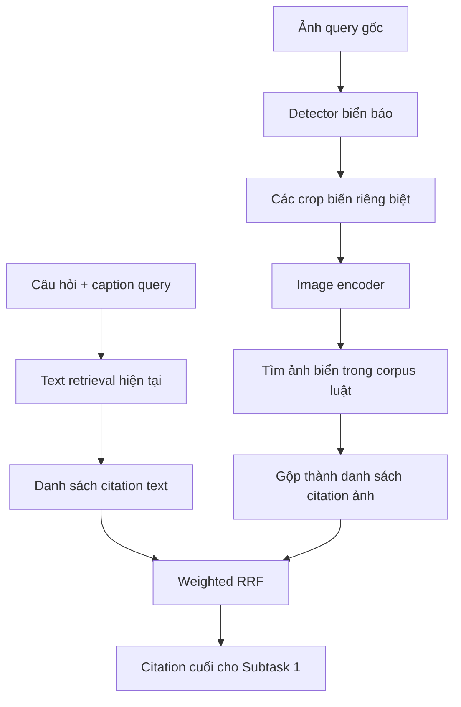

# Kế hoạch Hybrid Text–Image Retrieval cho MLQA-TSR

Ngày tổng hợp: 20/10/2026.

## 1. Mục tiêu và phạm vi

Xây dựng hướng trung gian giữa pipeline caption-based text RAG hiện tại và hướng cho VLM trực tiếp đọc ảnh khi trả lời:

- Text và ảnh truy xuất citation độc lập.
- Nhánh ảnh dùng mạng detection nhỏ để tìm biển trước khi embedding, tránh vector bị chi phối bởi nền ảnh đường phố.
- Một ảnh có nhiều biển tạo nhiều crop/vector; không chỉ lấy một biển hoặc trung bình toàn bộ vector.
- Hợp nhất hai danh sách ở cấp citation bằng công thức có trọng số, chọn cấu hình trên dev.
- Subtask 2 giữ QA bằng văn bản/caption trong thí nghiệm đầu, không đưa ảnh gốc vào model trả lời.

Đây là tài liệu kế hoạch, chưa triển khai code, tải dữ liệu, cài dependency hoặc chạy model. Những model, ngưỡng và trọng số dưới đây là đề xuất ban đầu, chưa được xác nhận tối ưu. Mọi đường dẫn output/code mới phải được thống nhất trước khi triển khai theo AGENTS.md.

## 2. Phân biệt với pipeline hiện tại

Pipeline hiện tại đã dùng thông tin ảnh gián tiếp: ảnh query/corpus được caption, sau đó BGE-M3 embedding text; QA cũng nhận text/caption. Vì vậy, baseline được gọi chính xác là caption-based text retrieval và text-only reasoning.

“Hybrid” hiện tại là corpus retrieval + example retrieval. “Hybrid text–image” trong kế hoạch này là tầng hợp nhất mới giữa nhánh ngôn ngữ và nhánh thị giác.

Phiên bản đầu giữ nguyên nhánh text hiện tại, bao gồm caption và hai nhánh corpus/example. Bỏ caption khỏi nhánh text sẽ là ablation riêng, không tự thực hiện cùng lúc vì làm thay đổi baseline.

## 3. Kiến trúc đề xuất



Nhánh ảnh phiên bản đầu tìm trực tiếp ảnh biển trong corpus luật. Chưa thêm image-example retrieval để tránh đồng thời phát sinh nhiều tầng fusion. Nhánh text vẫn giữ example retrieval đã có.

Citation đầu ra vẫn là cặp law_id/article_id theo benchmark. Crop và image_id là bằng chứng truy xuất nội bộ, không làm thay đổi schema submission.

## 4. Dataset để detector học, không gán box VLSP từ đầu

### 4.1. Cách học

Dùng dataset ngoài đã có bounding box để fine-tune detector pretrained. Không phải tự vẽ box cho toàn bộ ảnh VLSP. Chỉ đưa ảnh không nhãn vào YOLO không đủ để huấn luyện detection theo cách supervised thông thường.

Ứng viên dữ liệu đã tìm được:

| Dataset | Thông tin công bố | Vai trò đề xuất |
| --- | --- | --- |
| [Traffic-sign-detection-VietNam](https://huggingface.co/datasets/star092304/Traffic-sign-detection-VietNam) | Dataset card báo 10.157 ảnh, 82 lớp, box định dạng YOLO, license hiển thị CC BY 4.0 | Kiểm tra đầu tiên vì có ảnh biển Việt Nam |
| [Vietnam-Traffic-Sign trên Roboflow](https://universe.roboflow.com/vietnamtrafficsign/vietnam-traffic-sign/dataset/1) | Object detection, xuất được YOLO; v1 hiển thị 3.659 ảnh sau augmentation; license CC BY 4.0 | Nguồn thay thế, không mặc định trộn với nguồn đầu |
| [Mapillary Traffic Sign Dataset](https://arxiv.org/abs/1909.04422) | 100.000 ảnh đường phố; 52.000 ảnh fully annotated và 48.000 ảnh partially annotated theo paper | Nguồn mở rộng nếu dữ liệu nhỏ chưa đủ |

Thông tin trên mới đối chiếu trang phát hành, chưa tải/kiểm kê file. Dataset đầu có số liệu labeled/background trong bảng chưa nhất quán; không coi số lượng công bố là kết quả kiểm kê. Viewer 82 hàng là bảng lớp, không phải chỉ có 82 ảnh. Cần xác minh nguồn gốc và điều kiện sử dụng trước khi chọn.

### 4.2. Chuẩn hóa nhãn

- Gộp các lớp thực sự là biển báo thành một lớp `traffic_sign`; giữ mọi box.
- Loại nhãn của đối tượng không thuộc mục tiêu, chẳng hạn đèn giao thông có trong dataset ứng viên đầu. Không đổi tất cả class ID thành biển một cách máy móc.
- Kiểm tra biển phụ, biển nhỏ và biển xa có được gán đầy đủ không. Gộp lớp không tạo thêm box bị thiếu.
- Kiểm tra box hợp lệ, ảnh hỏng, ảnh không nhãn và background; không mặc định mọi ảnh thiếu label đều là ảnh âm tính.
- Kiểm tra ảnh trùng/gần trùng giữa các split và với VLSP. Các phiên bản augmentation của một ảnh phải ở cùng split; ưu tiên chia theo ảnh gốc/chuỗi chụp nếu biết nguồn.
- Không đưa ảnh dev/test VLSP vào training hoặc pseudo-label training. Nếu ảnh dùng chung giữa các split, phải báo rõ và tránh dùng ảnh đó để thích nghi detector rồi gọi là đánh giá trên ảnh chưa thấy.

### 4.3. Ranh giới benchmark

[Quy định VLSP MLQA-TSR](https://vlsp.org.vn/vlsp2025/eval/legalqa) nêu không dùng external datasets. Detector train bằng các nguồn trên thuộc thiết lập nghiên cứu mở rộng; cần báo rõ dữ liệu ngoài, không diễn giải là cùng điều kiện với hệ thống chỉ dùng dữ liệu challenge.

Việc model pretrained công khai được sử dụng và việc bổ sung dataset để fine-tune là hai vấn đề khác nhau. Không suy từ quyền dùng pretrained model thành quyền dùng thêm dữ liệu huấn luyện.

## 5. Detector biển báo

### 5.1. Model và mục tiêu

Ứng viên: YOLO11n, khoảng 2,6 triệu tham số theo [tài liệu chính thức](https://docs.ultralytics.com/models/yolo11/). Fine-tune từ trọng số pretrained, không train từ đầu.

Detector chỉ định vị lớp `traffic_sign`, gồm biển chính và biển phụ nếu dữ liệu có nhãn tương ứng. Không cần học hàng trăm mã biển. Output mỗi detection: bbox và confidence. Image encoder đảm nhiệm biểu diễn để tìm biển tương tự.

Không mặc định trọng số COCO nhận đầy đủ biển Việt Nam. Độ phân giải đầu vào, ngưỡng confidence và NMS cần chọn bằng validation detection; biển nhỏ có thể đòi hỏi độ phân giải cao hơn. Không thêm tiling/segmentation trong phiên bản đầu nếu chưa có bằng chứng cần thiết.

### 5.2. Crop và nhiều biển

- Giữ các box hợp lệ sau NMS, không chỉ lấy box confidence cao nhất.
- Mỗi box tạo một crop và một vector riêng.
- Có thể mở rộng box 5–10% mỗi chiều để giữ viền; đây là khoảng thử, phải giới hạn theo biên ảnh.
- Bảo toàn tỉ lệ ảnh khi chuẩn bị input; không kéo méo biển. Dùng cùng preprocessing của encoder ở query/corpus và kiểm tra không cắt mất chi tiết ở mép.
- Không lật ngang ảnh khi augmentation vì trái/phải có ý nghĩa khác nhau.
- Không bỏ biển chỉ vì diện tích nhỏ; kiểm tra khả năng biểu diễn của các crop quá nhỏ/mờ.
- Lưu tọa độ gốc, confidence và lý do loại box để truy vết. Nếu cần giới hạn số detection vì tài nguyên, phải cấu hình và báo số bị cắt.

Biển chính và biển phụ giữ box riêng. Detection không tự giải quyết quan hệ biển phụ áp dụng cho biển chính nào, hay biển gắn với làn đường nào. Bản đầu để text/caption cung cấp ngữ cảnh; chưa thêm mạng quan hệ không gian.

### 5.3. Không gán box VLSP để train trong bản đầu

Train bằng dataset có nhãn ngoài, đánh giá trên validation của dataset đó rồi áp dụng trực tiếp sang VLSP. Kiểm tra trực quan một số ảnh VLSP có box dự đoán để phát hiện lỗi rõ ràng.

Không có box chuẩn VLSP vẫn chấm được F2 citation cuối, nhưng không thể định lượng chính xác detection recall trên VLSP. Nếu cần metric này, phải có một tập đánh giá nhỏ với box được xác minh; việc đó là lựa chọn sau, không phải điều kiện bắt đầu.

Nếu detector chuyển miền kém, cân nhắc pseudo-label trên ảnh train VLSP: model dự đoán box, người dùng sửa phần sai/thiếu rồi fine-tune. Không mặc định pseudo-label là ground truth; các biển bị bỏ sót có thể tiếp tục bị bỏ sót sau self-training. Chưa thực hiện pseudo-label trong bản đầu.

## 6. Chuẩn bị kho ảnh biển của corpus luật

Đơn vị index là từng hình biển, không mặc định một file ảnh tương ứng một biển.

```text
crop/image biển → image_id → block nguồn → citation hợp lệ trong registry
```

- Hình đã chứa một biển: dùng trực tiếp.
- Hình chứa nhiều biển: tách các vùng biển; giữ liên kết với block/citation nguồn.
- Có thể thử detector để hỗ trợ tách, nhưng phải kiểm tra chuyển miền từ ảnh thực tế sang hình vẽ luật. Dataset đường phố không bảo đảm xử lý đúng montage trong corpus.
- Chỉ tách tự động khi liên kết nguồn rõ; không tự suy mã biển/citation từ tên file hoặc prediction model.
- Nếu chưa tách đáng tin cậy được một ảnh corpus, ghi trạng thái chưa hỗ trợ; không coi là đã index đầy đủ. Phương án sửa crop thủ công hay đổi cách tách phải được thống nhất sau.
- Một hình được nguồn liên kết với nhiều citation thì giữ đủ các liên kết; ánh xạ theo cấu trúc luật, không dùng đáp án test để gán.
- Citation không có hình vẫn do nhánh text tìm được.

Trước khi embedding, cần báo số ảnh nguồn, số crop hợp lệ, số ảnh nhiều biển chưa xử lý và số citation được nhánh ảnh bao phủ.

## 7. Image embedding và tính điểm nhiều biển

### 7.1. Encoder

Ứng viên ban đầu: [SigLIP base patch16-224](https://huggingface.co/google/siglip-base-patch16-224), đóng băng trọng số. Dùng đặc trưng ảnh, chuẩn hóa L2 và cùng preprocessing cho query/corpus. Chưa fine-tune encoder; chưa khẳng định model này phân biệt đủ các biển gần giống.

Detector định vị; encoder tạo vector. Không dùng trực tiếp feature detector làm retrieval embedding nếu chưa có thực nghiệm xác nhận.

### 7.2. Truy xuất từng crop

Giả sử query có m crop với vector chuẩn hóa u_1,...,u_m. Với citation a, V_a là tập vector hình biển được ánh xạ tới a.

Điểm crop–citation:

```text
s_i(a) = max_{v ∈ V_a} (u_i · v)
```

Tích vô hướng bằng cosine vì vector đã chuẩn hóa L2. Citation không có hình không có điểm nhánh ảnh, không gán giả similarity bằng 0 rồi đưa vào xếp hạng.

Quy trình:

1. Mỗi crop tìm top-L ảnh biển corpus.
2. Ánh xạ các ảnh sang citation; hợp kết quả từ mọi crop thành tập C_I.
3. Với mỗi citation ứng viên, tính điểm trên các vector liên quan:

```text
S_I(a) = max_{i=1,...,m} s_i(a)
```

4. Xếp citation theo S_I giảm dần và loại trùng citation.

Max phù hợp với mục tiêu “ít nhất một biển hỗ trợ citation”. Không trung bình tất cả crop vì các biển khác trong cảnh không phải bằng chứng phủ định citation của một biển. Không cộng điểm theo số box lặp hoặc số hình luật để tránh tăng điểm chỉ vì nhiều bản sao. Tuy nhiên, citation có nhiều hình vẫn có nhiều cơ hội đạt max cao; cần quan sát thiên lệch này khi phân tích lỗi.

Ví dụ ảnh có biển cấm dừng, giới hạn tốc độ và biển phụ thời gian: cả ba crop đều được tìm riêng và có thể đóng góp citation khác nhau. Không chọn một biển duy nhất đại diện toàn ảnh.

Confidence detector dùng để lọc box, không coi là xác suất citation đúng và không dùng trực tiếp làm trọng số fusion. Một biển được detect rõ vẫn có thể không liên quan câu hỏi.

## 8. Hợp nhất bằng Weighted RRF

### 8.1. Lý do

Cosine BGE-M3 và cosine image encoder không cùng phân bố; không cộng trực tiếp hai điểm thô hoặc mặc định cùng cosine là cùng độ liên quan. [RRF](https://cormack.uwaterloo.ca/cormack/cormacksigir09-rrf.pdf) kết hợp theo thứ hạng; Weighted RRF dưới đây là lựa chọn thiết kế cho hai nhánh.

Ký hiệu:

- C_T, C_I: tập citation ứng viên text và ảnh.
- r_T(a), r_I(a): thứ hạng từ 1 trong từng danh sách sau khi gộp citation.
- λ: trọng số text, thuộc [0,1]; trọng số ảnh là 1−λ.
- k: hằng số làm giảm chênh lệch giữa các hạng.

```text
S(a) = λ × 1[a ∈ C_T] / (k + r_T(a))
     + (1−λ) × 1[a ∈ C_I] / (k + r_I(a))
```

Một nhánh không có citation thì đóng góp bằng 0, không cần định nghĩa rank cho phần tử vắng. Lấy union C_T ∪ C_I, xếp theo S rồi chọn top-N. Quy định tie-break cố định, không phụ thuộc thứ tự đọc file, và ghi vào cấu hình.

λ=0,6; k=60 chỉ là cấu hình minh họa, không phải kết quả tối ưu:

| Citation | Hạng text | Hạng ảnh | Điểm |
| --- | ---: | ---: | ---: |
| A | 1 | 3 | 0,01619 |
| B | 2 | Không có | 0,00968 |
| C | Không có | 1 | 0,00656 |

k=60 làm chênh lệch hạng đầu khá nhỏ, ưu tiên đáng kể sự đồng thuận hai nhánh. Cần so với k nhỏ hơn như 10. Các điểm RRF không phải xác suất đúng.

### 8.2. Độ sâu ứng viên và fallback

- Nhánh text cần cung cấp danh sách trước cutoff cuối; đề xuất thử độ sâu 20 citation. Không chỉ tái dùng top-5 submission nếu muốn đánh giá top-N lớn hơn.
- Giữ logic text hiện tại làm baseline; việc xuất ứng viên rộng hơn phục vụ fusion phải được mô tả rõ vì có thể tác động hành vi high gate.
- Nhánh ảnh dùng union top-L ảnh của mỗi crop; gộp citation trước fusion.
- Không detect được biển hoặc không còn ứng viên ảnh hợp lệ: dùng thứ hạng text và top-N, ghi lý do fallback.
- RRF không tự biết mọi ảnh khớp đều kém. Chỉ thêm ngưỡng similarity loại nhánh ảnh sau khi đo phân bố trên dev; không tự đặt một ngưỡng chung cho encoder.
- Chưa dùng trọng số động theo detection confidence hay mạng fusion học được.

## 9. Chọn cấu hình trên dev

Làm lần lượt thay vì tối ưu đồng thời mọi tham số:

| Bước | Giá trị khởi đầu/phạm vi thử | Tiêu chí |
| --- | --- | --- |
| Detector | Confidence, NMS, độ phân giải theo validation có box | Recall biển, precision, box trùng; phân tích biển nhỏ/biển phụ |
| Ứng viên ảnh | L ∈ {5,10} ảnh mỗi crop | Recall citation ứng viên, thời gian |
| Fusion | λ ∈ {0;0,25;0,5;0,75;1}; k ∈ {10,60} | Mean F2 dev |
| Output | N ∈ {3,5,7,10} | Mean F2 dev, precision/recall |

λ=0 và λ=1 là mốc image-only/text-only tại cùng cách lấy ứng viên/cutoff. Báo riêng baseline text gốc nếu cách cutoff/gate khác. Nếu λ ảnh bằng 0, không đưa citation chỉ có ở ảnh vào kết quả vì các phần tử đó có điểm 0; tương tự cho λ text bằng 0.

Chọn bằng mean F2 theo evaluator hiện tại, không bằng accuracy nhận dạng biển. Khi cấu hình gần nhau, ưu tiên ổn định và đơn giản. Đóng băng cấu hình trước khi đánh giá test; không tune bằng private test.

Dev dùng train làm example bank; không dùng chính dev/gold dev để tạo ứng viên example. Các lỗi citation/registry đã biết của baseline phải giữ cùng chính sách chấm giữa các cấu hình; không đồng thời sửa nhãn rồi so điểm như thể chỉ thay retrieval.

## 10. Thí nghiệm và đánh giá

### 10.1. Ablation tối thiểu

| Cấu hình | Mục đích |
| --- | --- |
| Text hiện tại | Baseline |
| Image-only từ toàn ảnh query | Mốc đo tác dụng crop, giữ cùng encoder và corpus index |
| Image-only từ crop detector | Đo tác dụng detector |
| Text + image crop, Weighted RRF | Đo giá trị bổ sung của nhánh ảnh |

Giữ cùng split, registry, encoder ảnh và corpus index khi so toàn ảnh/crop. Chọn cấu hình trên dev. Chưa đổi QA/model caption/few-shot cùng lúc.

### 10.2. Metric cần báo

- Citation: mean F2 chính thức, precision, recall; recall tập ứng viên trước cutoff.
- Detector: metric detection trên validation có box; recall theo kích thước biển nếu nhãn cho phép.
- Phân tích VLSP: một biển, nhiều biển, không detection, biển phụ, ảnh mờ, citation không có hình. Không gọi nhóm dựa trên prediction là số lượng biển chuẩn nếu chưa xác minh.
- Đóng góp fusion: citation đúng chỉ text tìm được, chỉ ảnh tìm được, cả hai tìm được; số mẫu fusion cải thiện/làm giảm F2.
- Tài nguyên: thời gian detection/embedding/retrieval/fusion, VRAM, số crop mỗi ảnh và số fallback.

Nếu không có box chuẩn VLSP, chỉ báo quan sát trực quan và kết quả citation; không công bố detection recall VLSP như đã đo. Tách lỗi detection, visual matching và fusion khi đủ bằng chứng.

## 11. Subtask 2 và đánh giá toàn chuỗi

Thí nghiệm đầu giữ inference text/caption hiện tại. Theo benchmark, Subtask 2 nhận relevant_articles được cung cấp, độc lập với prediction Subtask 1; vì vậy cải thiện F2 không tự làm thay đổi accuracy QA benchmark.

Nếu đánh giá hệ thống thực tế, chạy riêng retrieval → QA bằng citation dự đoán và báo accuracy end-to-end. Không trộn kết quả đó với accuracy dùng citation được cung cấp. Không đưa ảnh gốc vào QA trong hướng trung gian đang nghiên cứu.

## 12. Tái lập và quy tắc triển khai sau này

Cần lưu khi được phép triển khai:

- Nguồn/version/license dataset detection, số ảnh/box thực tế, cách gộp lớp và split, kết quả kiểm tra trùng.
- Detector: pretrained checkpoint, checkpoint fine-tune/hash, seed, config training, validation metrics.
- Image encoder/hash/revision, preprocessing, pooling và normalization cụ thể.
- Bbox/confidence, ảnh nguồn/hash, crop tọa độ và trạng thái; có thể tái tạo crop từ ảnh gốc, chưa cần lưu file crop riêng.
- Mapping crop corpus → block → citation và số ảnh chưa xử lý.
- Rank/điểm từng nhánh, λ/k/L/N, tie-break, cutoff, fallback, prediction, metric và tài nguyên.
- Giữ trace hỗ trợ nhiều biển để giải thích citation đến từ crop nào.

Training/captioning/embedding/inference dài chỉ cung cấp lệnh cho người dùng tự chạy, trừ khi được yêu cầu rõ ràng tự chạy. Dùng Python/package trong `.venv`. Các tác vụ dài phải log khoảng 30 giây/lần: bước, đã xử lý/tổng, phần trăm, thời gian và ETA.

Không thêm self-check/demo/test riêng chỉ để kiểm tra nội bộ; dùng validation detection, CLI/pipeline thực tế và evaluator của bước tương ứng. Không commit dataset, weights, vector index, cache, môi trường hoặc secrets; không tự sửa `.gitignore`.

Tài liệu này chưa ấn định đường dẫn code/output mới hoặc đưa lệnh chưa tồn tại. Khi bắt đầu triển khai cần thống nhất các file/path cần tạo. README không được sửa trong tác vụ ghi kế hoạch này theo yêu cầu người dùng.

## 13. Thứ tự thực hiện đề xuất

1. Xác nhận thiết lập dùng dataset ngoài là nghiên cứu mở rộng; kiểm kê một nguồn detection Việt Nam có nhãn sẵn.
2. Chuẩn hóa lớp, kiểm tra split/ảnh trùng và độ đầy đủ nhãn, nhất là biển phụ.
3. Fine-tune YOLO11n một lớp, đánh giá bằng box chuẩn của dataset ngoài.
4. Áp dụng detector lên VLSP; kiểm tra chuyển miền, không mặc định cần gán box VLSP để train.
5. Chuẩn bị kho ảnh biển corpus và mapping citation; xác minh ảnh nhiều biển.
6. Embedding bằng SigLIP đóng băng; đo image-only toàn ảnh và crop.
7. Hợp nhất với text bằng Weighted RRF, chọn λ/k/N trên dev.
8. Đóng băng cấu hình, đánh giá test và báo riêng điều kiện dùng dữ liệu ngoài.
9. Chỉ cân nhắc pseudo-label/thích nghi detector, fine-tune encoder hoặc image-example retrieval khi phân tích lỗi chỉ ra nhu cầu.

## 14. Rủi ro và quyết định chưa chốt

- Dữ liệu detection ngoài có thể thiếu biển phụ hoặc không giống ảnh VLSP; không bảo đảm detector chuyển miền tốt.
- Detector đường phố có thể không tách tốt hình minh họa/montage trong corpus. Chưa chốt cách xử lý tự động toàn bộ phần này.
- Image encoder tổng quát có thể nhầm biển chỉ khác con số, mũi tên hoặc ký hiệu nhỏ.
- Crop làm mất quan hệ làn đường, hướng xe và biển chính/phụ; text/caption vẫn cần thiết.
- Nhánh ảnh không biết câu hỏi đang nhắm biển nào; biển không liên quan có thể sinh citation nhiễu.
- Max similarity bảo toàn ứng viên của từng biển nhưng dễ bị một khớp nhầm chi phối.
- RRF kết hợp thứ hạng, không hiệu chỉnh chất lượng tuyệt đối; cần đo trước khi thêm rejection threshold hoặc trọng số động.
- Không phát hiện được biển sẽ fallback text; giữ thống kê để không che mất giới hạn nhánh ảnh.
- Dùng dataset ngoài thay đổi điều kiện so sánh benchmark; phải công bố rõ.
- Chưa xác nhận tốc độ, VRAM, chất lượng detector/encoder hoặc mức tăng F2 trên máy và dữ liệu hiện tại.

## 15. Tài liệu tham khảo

- [VLSP 2025 MLQA-TSR: task, metric và quy định](https://vlsp.org.vn/vlsp2025/eval/legalqa).
- [YOLO11: model và training](https://docs.ultralytics.com/models/yolo11/).
- [Traffic-sign-detection-VietNam: dataset card và annotation format](https://huggingface.co/datasets/star092304/Traffic-sign-detection-VietNam).
- [Vietnam-Traffic-Sign trên Roboflow, v1](https://universe.roboflow.com/vietnamtrafficsign/vietnam-traffic-sign/dataset/1).
- [Mapillary Traffic Sign Dataset: paper gốc](https://arxiv.org/abs/1909.04422).
- [SigLIP base patch16-224: model card](https://huggingface.co/google/siglip-base-patch16-224).
- [Reciprocal Rank Fusion: paper gốc](https://cormack.uwaterloo.ca/cormack/cormacksigir09-rrf.pdf).
- [Hybrid Dual-Branch Retrieval cho cùng challenge](https://aclanthology.org/2025.vlsp-1.51.pdf): tham khảo corpus/example retrieval và VLM QA; không phải kiến trúc trung gian được chốt ở đây.

Các nguồn được tra cứu trong trao đổi trước khi lập kế hoạch; khả năng tải và chất lượng file dataset thực tế chưa được xác minh.
